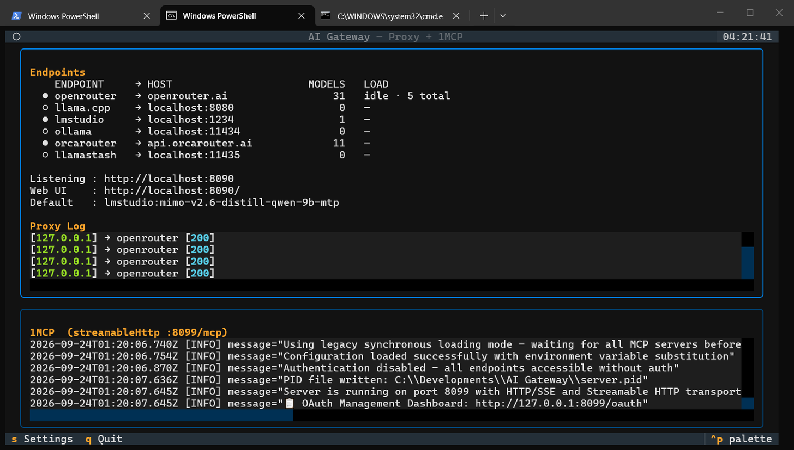
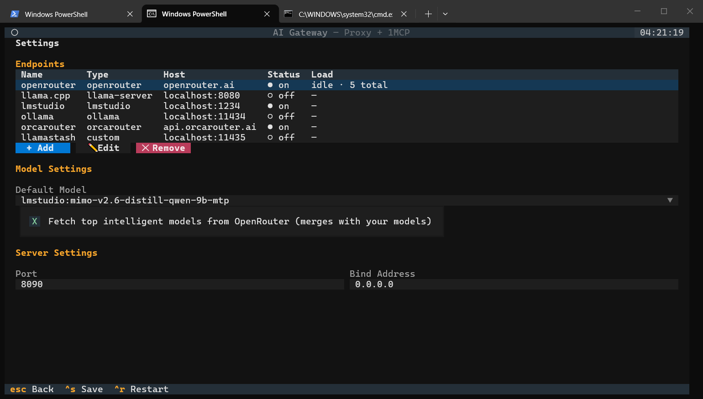
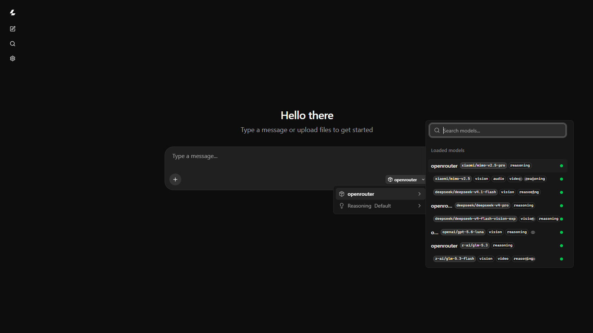

# AI Gateway — Multi-Endpoint OpenAI-Compatible Proxy with Web Chat UI

A multi-endpoint proxy that connects to several AI backends simultaneously — OpenRouter, OrcaRouter, LM Studio, llama.cpp server, and any custom OpenAI-compatible endpoint. It checks their health, aggregates their models into a unified catalog, and routes requests based on model ID prefixes. Works as a single API server for your entire local network.

**Use cases:**
- **Homes** — Share a single paid OpenRouter account with all family devices, while also running local models
- **Testing environments** — Developers and QA can access cloud and local AI without managing individual API keys
- **Cline / AI agents** — Point any agent client to `http://YOUR_PC:8090` and it just works
- **Private chat** — Anyone on the LAN gets a full chat UI without needing their own account

## What It Does

```
┌──────────────────────────────────────────────────────────────┐
│  AI Gateway (192.168.1.100:8090)                             │
│                                                              │
│  proxy.py ─┬─► OpenRouter API ──► Cloud AI Models           │
│            ├─► OrcaRouter API ──► Cloud AI Models           │
│            ├─► llama.cpp :8080 ──► Local GGUF Models        │
│            ├─► LM Studio :1234 ──► Local Models             │
│            ├─► Ollama :11434 ──► Local Models               │
│            └─► Custom Endpoint ──► Any OpenAI-compatible     │
│      │                                                       │
│      ├── Terminal TUI (endpoint mgmt, model switch)         │
│      └── Web Chat UI (browser-based)                        │
│                                                              │
└──────────┬──────────┬──────────┬────────────────────────────┘
           │          │          │
     ┌─────┴──┐  ┌────┴───┐  ┌──┴────────┐
     │ Phone  │  │ Laptop │  │ Cline/Agent│
     │ Web UI │  │ Web UI │  │ API client │
     └────────┘  └────────┘  └────────────┘
```

**Multiple endpoints, one proxy, zero client configuration.**

### Screenshots

| Split-View TUI | Settings | Web Chat UI |
|:---:|:---:|:---:|
|  |  |  |

### For AI Agent Users (Cline, etc.)
The gateway exposes both OpenAI-compatible and LM Studio-compatible endpoints. For the best experience with Cline:

1. Select **"LM Studio"** as the API provider in Cline
2. Set the base URL to `http://YOUR_PC_IP:8090` (no `/v1` needed)
3. The model dropdown populates automatically

The proxy handles the API key, model selection, and routing. Switch models from the TUI and all connected agents instantly use the new model.

### For Chat Users
Open `http://YOUR_PC_IP:8090/` in any browser on the network. Full chat interface with conversation management, file attachments, markdown rendering, and model switching — no account needed.

## Quick Start

```bash
# 1. Clone or download this project
# 2. Copy config.example.json to config.json and add your endpoints + API keys
#    (config.json is gitignored — never commit your real API keys)
# 3. Run (recommended — split-view TUI: proxy GUI + 1MCP MCP bridge):
python gateway_tui.py
#    or just double-click run.cmd
#    (plain proxy only, no MCP bridge: python proxy.py)

# That's it. Open http://localhost:8090/ for the chat UI.
# Other devices: http://YOUR_IP:8090/
```

## Model ID Format

Model IDs use a `source/vendor/model` prefix to route requests to the correct endpoint:

```
openrouter/openai/gpt-5.6-luna        → OpenRouter → openai/gpt-5.6-luna
openrouter/deepseek/deepseek-v4-flash  → OpenRouter → deepseek/deepseek-v4-flash
orcarouter/openai/gpt-4o-mini          → OrcaRouter → openai/gpt-4o-mini
orcarouter/anthropic/claude-sonnet-4.6 → OrcaRouter → anthropic/claude-sonnet-4.6
llama.cpp/qwen3-8b                     → llama.cpp server → qwen3-8b
lmstudio/mistral-7b                    → LM Studio → mistral-7b
ollama/llama3                          → Ollama → llama3
```

The `source` prefix is the endpoint name. The rest is the original model ID as known by the upstream endpoint.

## Features

### Proxy Server
- Multi-endpoint support (OpenRouter, OrcaRouter, LM Studio, llama.cpp, Ollama, custom)
- Health checking every 30 seconds with status display
- Automatic model aggregation from all online endpoints
- Smart routing: model ID prefix → correct endpoint
- SSE streaming for all endpoints
- Automatic model injection when client doesn't specify one
- CORS headers for cross-origin access
- Auto-discovery of local endpoints (llama-server on :8080, LM Studio on :1234, Ollama on :11434)

### Terminal Dashboard (TUI)
- Live proxy log showing all requests
- Endpoint status panel (online/offline with model counts) and a per-endpoint **load** column — in-flight requests and total requests served (e.g. `⚡ 2 active · 17 total`, `idle · 12 total`, `—` if never used)
- [Live stats](#live-stats) beside the endpoint list, and a full dashboard on `d`: cache hits, speed, GPU, saved chats, and totals per app and model
- [Tool calls healed and stopped](#tool-call-healing) are counted beside the other live stats
- Settings with model selection, port, bind address, fetch top models toggle
- Footer key bindings: `s` Settings, `d` Dashboard, `q` Quit, `Ctrl+S` Save, `Ctrl+R` Restart
- Consistent scrollable layout across all screens
- Save/load settings from `config.json`

### Split-View TUI (`gateway_tui.py`)
- Runs the proxy **and** [1MCP](https://github.com/1mcp-app/agent) (an MCP aggregator) in one terminal
- Top pane: the full proxy GUI (endpoint status, server info, live log, Settings via `s`)
- Bottom pane: live 1MCP output — **every** server in `mcp.json` aggregated behind ONE streamable-HTTP endpoint on `:8099/mcp`
- Reuses `proxy.py`'s TUI via subclassing — `proxy.py` is not modified
- Clean shutdown on `q` (kills the 1MCP process tree, stops the proxy server)
- Windows-compatible `npx` launch; requires Node.js/npx on PATH

### Web Chat UI
- Powered by [llama.cpp's llama-ui](https://github.com/ggml-org/llama.cpp/tree/master/tools/ui)
- Streaming responses with real-time token display
- Model selector with all configured models (from all endpoints)
- Conversation management (create, branch, edit, delete, search)
- File attachments (images, PDFs, audio, text)
- Markdown with syntax highlighting and math formulas
- Dark/light theme
- MCP server support (attach tools/resources; "Use llama-server proxy" toggle)

#### Displaying Full Raw Model Identifiers

By default, the model selector shows parsed, human-friendly model names with badges (e.g. `GLM-4.7-Flash` with a `Q8_0` quantization badge). To see the **full raw model identifier** — including the source prefix and the complete upstream model ID — enable the **"Show raw model names"** option:

1. Open the **Settings** screen (gear icon in the sidebar)
2. Go to the **Display** section
3. Toggle **"Show raw model names"** on

When enabled, model names are shown in their complete form, e.g.:

```
openrouter/ggml-org/GLM-4.7-Flash-GGUF:Q8_0
llama.cpp/mistral-7b-instruct-v0.3
lmstudio/llama-3.2-8b-instruct
```

This is especially useful with the AI Gateway's multi-endpoint setup, since the `source/vendor/model` prefix makes it clear which endpoint serves each model. The setting is saved in the browser's localStorage and applies immediately.

## MCP Servers (Tools & Resources)

The web UI can attach **MCP servers** to the chat so the model can call external tools and read resources. HTTP/S MCP servers (Streamable HTTP or SSE) are added by URL in the MCP Servers screen.

- **"Use llama-server proxy"** — routes the MCP server's traffic through the gateway's `/cors-proxy` endpoint, bypassing browser CORS/mixed-content restrictions. Enable this for local HTTP MCP servers or any server that doesn't send CORS headers. `/cors-proxy` only answers the gateway's own web page (and non-browser clients): a page from another site gets `403`, so it can't use the gateway to reach services that only listen on this PC. Open the web UI by IP, `localhost`, the PC's name (`my-pc`) or a `.local`/`.lan`/`.home` name; a name with a public domain is refused, which blocks DNS-rebinding.
- **Session support** — the proxy forwards the MCP session handshake (`Mcp-Session-Id`) so stateful MCP servers work.

> **Command/stdio servers** (e.g. ComfyUI's `comfyui_mcp.py`, `@modelcontextprotocol/server-filesystem`) are not spawned by the proxy itself. Instead, list them in **`mcp.json`** (gitignored) and the split-view TUI (`gateway_tui.py`) launches [1MCP](https://github.com/1mcp-app/agent), which aggregates **all** of them behind a single streamable-HTTP endpoint on `:8099/mcp` — one port for any number of MCP servers:
>
> ```json
> {
>   "mcpServers": {
>     "comfyui":   { "type": "stdio", "command": "python", "args": ["C:/tools/comfyui/comfyui_mcp.py"] },
>     "filesystem": { "type": "stdio", "command": "npx", "args": ["-y", "@modelcontextprotocol/server-filesystem", "C:/path/to/folder"] }
>   }
> }
> ```
>
> Then add `http://localhost:8099/mcp` as **one** MCP URL with the proxy toggle on — you'll get every server's tools (namespaced `server___tool`).

## Configuration

Edit `config.json`:

```json
{
  "endpoints": [
    {
      "name": "openrouter",
      "type": "openrouter",
      "host": "openrouter.ai",
      "enabled": true,
      "api_key": "sk-or-v1-YOUR_KEY_HERE"
    },
    {
      "name": "orcarouter",
      "type": "orcarouter",
      "host": "api.orcarouter.ai",
      "enabled": true,
      "api_key": "sk-orca-YOUR_KEY_HERE"
    },
    {
      "name": "llama.cpp",
      "type": "llama-server",
      "host": "localhost:8080",
      "enabled": true,
      "api_key": ""
    },
    {
      "name": "ollama",
      "type": "ollama",
      "host": "localhost:11434",
      "enabled": true,
      "api_key": ""
    },
    {
      "name": "llamastash",
      "type": "custom",
      "host": "localhost:11435",
      "enabled": true,
      "api_key": ""
    }
  ],
  "models": [
    "openrouter/openai/gpt-5.6-luna",
    "openrouter/deepseek/deepseek-v4-flash-0731",
    "openrouter/deepseek/deepseek-v4-flash-vision-exp",
    "openrouter/z-ai/glm-5.3-flash",
    "openrouter/google/gemini-3.5-flash"
  ],
  "default_model": "",
  "force_default_model": false,
  "port": 8090,
  "addr": "0.0.0.0",
  "fetch_top_models": false
}
```

| Field | Description |
|-------|-------------|
| `endpoints` | List of AI backends (name, type, host, api_key, enabled; optional `timeout` in seconds per upstream read — default 180 for cloud, 600 for local) |
| `models` | Your curated model list with `source/model` prefix format |
| `default_model` | Model ID used when a request names none (empty, or not currently available → the first available model) |
| `force_default_model` | When `true` (the **Force** checkbox next to Default Model in Settings), every chat request (`…/completions`, `/responses`, `/messages`) uses the default model, whatever model the client asks for; other requests such as embeddings are left alone |
| `port` | HTTP port (default: 8090) |
| `addr` | Bind address (`0.0.0.0` = all interfaces) |
| `fetch_top_models` | When `true`, fetches top 20 intelligent models from OpenRouter and merges with your models |

### Endpoint Types

| Type | Description | Health Check |
|------|-------------|-------------|
| `openrouter` | OpenRouter cloud API | `GET /api/v1/models` |
| `orcarouter` | OrcaRouter cloud API | `GET /api/v1/models` |
| `lmstudio` | LM Studio local server | `GET /v1/models` |
| `llama-server` | llama.cpp server | `GET /health` |
| `ollama` | Ollama local server | `GET /api/tags` |
| `strata` | Strata gateway (default `127.0.0.1:47831`) — vision and context follow the model loaded in Strata | `GET /v1/models` |
| `custom` | Any OpenAI-compatible endpoint (e.g. llamastash) | `GET /v1/models` |

## Long Chats on a Local Engine (KV Session Swap)

A local engine like Strata holds one conversation at a time. If several apps each keep a long chat there, every switch throws the held chat away, and the next request reads the other one again from scratch: 15+ minutes at 500k tokens.

With `kv_sessions` on, the gateway saves the held chat to disk and restores the right one before forwarding each request, so a switch takes seconds. Apps need no changes: chats are recognised by hashes of their messages.

**Turn it on (Strata):**

1. Create a folder for the session files, then add it to the model's run config (`strata-<model>.json`) and load the model again:
   ```json
   "slot_save_path": "D:\\Strata\\sessions"
   ```
2. Add this to the Strata endpoint in `config.json` and restart the gateway:
   ```json
   "kv_sessions": {"enabled": true}
   ```

The gateway finds the engine's port and key in Strata's own run files on each request. For another engine with the same slot API (`POST /slots/0?action=save|restore`), set `engine` and, if it has one, `engine_api_key`.

| Setting | Default | Meaning |
|---------|---------|---------|
| `enabled` | `false` | Turn the swap on for this endpoint |
| `engine` | found for Strata | `host:port` of the engine's own server |
| `engine_api_key` | found for Strata | That server's API key |
| `slot_dir` | found for Strata | The engine's session folder (only needed for `max_gb`) |
| `min_tokens` | `30000` | A shorter chat is cheap to read again, so it isn't saved |
| `min_gain_chars` | `4000` | Restore a saved chat only if it matches this many more characters than the held one |
| `idle_save_s` | `600` | Save the held chat after this many seconds without requests (`0` = off) |
| `max_gb` | `0` | Keep at most this much on disk, deleting the oldest of its own files first (`0` = never delete) |

**What it costs:**

| | Measured with Strata on an NVMe drive |
|---|---|
| Disk | About 16.7 KB per token: 1.7 GB at 104k tokens, about 8.5 GB at 512k (estimated) |
| Save / restore | 2.2 s / 3.0 s at 104k tokens, about 11 s / 15 s at 512k (estimated) |
| Reading the same chat from scratch | 274 s at 104k tokens, over 20 minutes at 370k |

- There is no limit on the number of swaps or saved chats except disk space. Set `max_gb` to cap it.
- A save rewrites the whole chat, and only happens if the chat changed since its last save. Switching back and forth often writes a lot to the SSD.
- The engine still runs one request at a time, so apps take turns.
- A chat comes back in full only if the app resends the same history. If it trims or rewrites older messages, the part after the first change is read again.

The gateway never opens session files, and its index (`kv-sessions-<endpoint>.json`) holds message hashes and counts only, never chat text. The index also records which chat the engine holds, so restarting the gateway doesn't make it forget. The first request after a restart checks that record against the engine's own token count. If the engine holds a long chat (`min_tokens` or more) that the gateway can't identify, no saved chat is restored over it, because it may be the same chat, newer than its saved copy. If another app uses the engine directly, the next switch back to a saved chat therefore reads it again once. `GET /health` shows the sessions, the held chat and the save and restore counts, and the log shows each swap. If the engine has slot saving off, requests are forwarded as usual and the log says what to change.

If the engine answers a save or restore with an error 500, swapping turns off until the model is reloaded, or for 30 minutes. Strata 0.1.57 can get into a state where every snapshot fails with `conversation snapshot: invalid K/V extent`. The console then shows **Swap: off until the model is reloaded** with the engine's reason, and `GET /stats` has it under `kv_sessions` as `suspended` and `last_error`. Reloading the model in Strata brings saving back.

## Live Stats

The console shows what the gateway and its engine are doing, refreshed every second. The main screen has a short **Live** panel beside the endpoint list. Press `d` for the full dashboard, and `d` or `Esc` to go back. Panels stack when the window is narrow.

| Panel | What it shows |
|-------|---------------|
| **Engine** | Model, state (reading with progress and time left, generating with speed, idle, not loaded), chat size against the context limit, requests in flight and queued |
| **Cache** | Prompt tokens reused, expert hit rate, drafts kept, chats parked in RAM, how each request found its chat (kept, restored, new), swap times, reading time saved |
| **Speed** | Output speed with a 60-second graph, reading speed, time to first token (median and p95), requests per minute, tokens per day |
| **Hardware** | GPU load, temperature, power, VRAM, PCIe traffic, CPU, RAM and disk |
| **Totals** | Requests, errors, tokens, cached share and time saved for this run, today and all time, plus cost when a cloud endpoint reports it |
| **Saved chats** | Each chat on disk: app, tokens, size, restores, last used. A dot marks the one in the engine |
| **Endpoints, Models, Apps** | Requests, tokens and cached share for each |
| **Recent requests** | Time, app, model, tokens, cached share, first token, speed, expert hits, what the swap did, how the reply ended (**End**) and the status |

Where the numbers come from:

- **Tokens and speed** are read from each response as it passes through, in the OpenAI, Anthropic, DeepSeek and Responses API formats, and from llama.cpp's `timings`. If an upstream reports no usage, streamed pieces are counted instead and shown with a `~`.
- **Engine, Hardware and the expert and draft figures** need an engine that publishes `/metrics`, which today means Strata. Other endpoints still get the gateway's own counts.
- **The app name** comes from the `X-Title` header. Without one, a browser on the gateway's own page shows as `Web UI`, then the referer's host is used, then the `User-Agent` product.
- **Time saved is an estimate:** cached tokens divided by the reading speed measured on that endpoint.
- **A client pressing stop** counts as stopped, not as an error.
- **How a reply ended** comes from the model's own stream, before any tool call healing. This helps when an agent stops on its own, because the model's last reply says why:

  | End | Meaning |
  |-----|---------|
  | `2 calls` | The reply made tool calls, so the app runs them and asks again |
  | `no call` | Tools were offered, but the reply was text only. An agent takes that as the end of its turn. If the text holds a tool call written out, `tool_heal` can turn it into a real one |
  | `cut off` | The reply hit the token limit (`max_tokens`, or the server's own response limit) |
  | `ctx full` | The context window filled up |
  | `no end` | The stream ended without saying why, which usually means it was cut off |
  | `empty` | No answer text, only reasoning, or nothing at all |
  | `answer` | A plain answer, with no tools offered |

  The log line spells it out, for example `ended: cut off at the token limit`.

No chat text is kept. The gateway reads token counts and timings from responses, and how each one ended: the finish reason, the number of tool calls and how many characters of text and reasoning it had. It passes the bytes on unchanged, and engine data is copied field by field from a fixed list. `gateway-stats.json`, beside `config.json` and gitignored, holds the all-time totals: counts plus endpoint, model and app names, with daily rows for 30 days. It's written every 30 seconds and on exit. Delete it to start the totals over.

`GET /stats` returns the same numbers as JSON. Like `/health` it needs no key, and it includes client addresses and app names, so anyone who can reach the gateway can read them.

## Tool Call Healing

Local models sometimes write a tool call out as plain text instead of making a real tool call. The client shows the text, nothing runs, and the turn ends. Damaged calls can also do harm: a client's own repair can turn `rm -rf C:\Users\me` into `rm -rf C:Usersme`.

Turn healing on per endpoint. In the console, open **Settings**, choose the endpoint, press **Edit** and tick **Heal tool calls**. **Check commands before they run (guard)** is ticked by default, and you can only change it while healing is on. The endpoint table's **Heal** column shows which endpoints have healing on. The change applies to the next request, with no restart. Or set it in `config.json`:

```json
{ "name": "strata", "type": "strata", "host": "127.0.0.1:47831", "tool_heal": { "enabled": true } }
```

It's off by default, and then every reply passes byte for byte. When it's on, it only touches `/chat/completions` requests that offer tools. A reply with nothing to repair keeps every character, though text that could have started a call may arrive split differently.

| The model replies with | What the client receives |
|---|---|
| A complete call written as text, with a real tool name | A proper tool call, which runs |
| A complete call written as text, with a name the client doesn't have | A proper tool call under that same name. Nothing runs, and the client tells the model which tools exist, so it can correct itself |
| No answer and no call, but the reasoning ends with `</think>` followed by complete calls in Gemma 4's format (`<\|tool_call>call:name{…}<tool_call\|>`) | Proper tool calls. This happens with Gemma 4 finetunes on LM Studio: the model closes its thinking with the wrong tag, so the server leaves the call inside the reasoning and the agent stops |
| A call in a code fence, or a tag mentioned in a sentence | The text, unchanged: that's a quotation |
| A written call that is incomplete or was cut off | The text, unchanged. It never runs |
| A proper tool call that is safe | The same bytes, held until the whole call has arrived |
| A command the guard stops | A question to you, or a message to the model (below) |

Tool names are never guessed, and parameter values are never edited.

### The command guard

Every call that would run is checked, healed or not, for accidents that come from errors. It splits commands the way bash, PowerShell or cmd would, using the shell the client's tool says it runs, so `grep -rn "rm -rf" src/` passes and `rm -rf ./dist` passes.

| Rule | What it stops | Example |
|---|---|---|
| A1 | Broken arguments on a command or file tool, because a client's repair can change what they mean | `{"commands":["rm -rf ./x", ]}` |
| T1 | A command or file call in a reply that was cut off | `finish_reason: length` |
| S01 | Deleting a path that is only a variable | `rm -rf "$DIR/"` |
| S02, S05 | Deleting a root, home, drive, system or top-level folder | `rm -rf ~`, `Remove-Item C:\ -Recurse` |
| S03 | A path that lost its backslashes | `rm -rf c:demo` |
| S04 | A PowerShell variable that was never set, so the path starts at the drive root | `Remove-Item "$dir\build" -Recurse` |
| S06, S13 | Deleting an unfiltered list | `Get-ChildItem -Recurse \| Remove-Item`, `find . -delete` |
| S09 | A redirect that empties a file | `sort data.txt > data.txt` |
| S10 | A control character in a path, usually a damaged `\n` or `\t` | `C:\temp` decoded with a tab |
| S11, S12 | Losing uncommitted work or history | `git reset --hard`, `git push --force origin main` |
| S14, S15, S16 | Disks, root permissions, shutting down, registry deletes | `mkfs`, `chmod -R 777 /`, `reg delete` |
| S17 | Commands that can't be read | `curl … \| sh`, `iex`, `powershell -enc` |
| S18, S19, S20 | Paths that climb out, unquoted spaces, empty paths | `rm -rf ../..`, `rm -rf ""` |

When a command is stopped, nothing of it reaches the client:

- **If the client offers `ask_question`,** you're shown the command and the reason, and your answer goes back to the model. The guard has no override, so a command you really want is yours to run yourself.
- **Otherwise, and for A1 and T1,** the model receives a call to a tool named like `gateway_stopped_S02_destructive_command_was_not_run`. The client answers that the tool doesn't exist, and the turn carries on with the rule in view.

Options, inside `tool_heal`:

| Option | Default | Effect |
|---|---|---|
| `guard` | `true` | `false` keeps the healing and turns off every check |
| `allow_rules` | `[]` | Rule ids to let through, such as `["S11"]` |

### What this can't do

- **It catches accidents, not intent.** A command can always hide what it does, for example inside a script or `npm run clean`. Keep your client's approval settings on.
- **It doesn't know the working folder,** so `rm -rf build` in the wrong folder passes.
- **In bash, a line break can't be told from a damaged `\n`,** because multi-line scripts are normal there. PowerShell and cmd ask you when a delete's path runs straight into a line break, so a script with a delete like that gets a question. Put `-Recurse` last or use `;` to avoid it.
- **A made-up tool name costs one retry,** and the model has to write the call again.
- **Calls are held until they're complete,** so a long file edit appears all at once rather than streaming. Keep-alive chunks are sent while it waits.
- **It only reads `/chat/completions` replies.** `/v1/messages` and `/v1/responses` pass untouched, and so does anything the engine serves directly.

Nothing about a reply is kept. The log and stats get counts and rule ids only.

## When a Chat Reaches the Context Limit

The gateway doesn't shorten or summarize chats. It makes sure your app can do that itself, at the right time:

- **Apps are told the context window that is loaded.** `/v1/models` (`context_length`, `context_window`, `max_model_len`) and `/props` (`n_ctx`) report what the model is loaded with, such as 32,000, and `max_context_length` holds the model's maximum. Agent apps use this number to decide when to compact, so a wrong one means they compact too late.
- **A full context reaches the app as the standard error.** When an engine answers that the prompt doesn't fit, each says it its own way (llama.cpp: "exceeds the available context size"). The gateway answers `400` with the OpenAI code `context_length_exceeded`, a message with the token counts where the engine gave them, and the engine's own words. Apps with overflow recovery, such as Cline, then compact and retry instead of stopping. `/v1/messages` gets Anthropic's form of the same error. Any other error passes byte for byte.
- **The console shows it coming.** From 90% of the window, the **In** column of Recent requests shows the share used, for example `241k 92%`, and the log line says `context 92% full`. A request that hit the limit shows `ctx full`.

## Thinking On or Off

Your app decides whether the model thinks, and the gateway delivers that choice to the endpoint. Nothing is set in the gateway's config.

Apps phrase this in different ways, and LM Studio's `/v1/chat/completions` only understands one of them, `reasoning_effort`. On LM Studio endpoints the gateway therefore copies your app's choice into `reasoning_effort`:

| Your app sends | LM Studio gets |
|----------------|----------------|
| `reasoning_effort` | It, unchanged |
| `chat_template_kwargs: {"enable_thinking": false}` (llama.cpp, vLLM) | `reasoning_effort: "none"` |
| `reasoning: {"enabled": false}` or `reasoning: {"effort": "low"}` (OpenRouter) | `"none"`, or that level |
| `thinking: {"type": "disabled"}` (Anthropic) | `"none"` |
| `think: false` (Ollama) | `"none"` |
| Thinking on with no level, or nothing at all | Nothing added: the model's **Enable Thinking** setting in LM Studio decides |

Your app's own `reasoning_effort` is never changed, and its other fields are passed on too. Other endpoint types, and LM Studio's `/v1/responses`, get the request exactly as sent.

This was tested with a Gemma 4 model. With `reasoning_effort: "none"`, LM Studio skipped thinking and still made the right tool call. It ignored `chat_template_kwargs` and `reasoning: {"effort"}`.

Each log line shows what your app asked for, such as `thinking off (asked)`, and `GET /stats` has it as `think`. That shows whether your app sends a choice at all.

## Connecting Clients

### Cline (Recommended)
Use the **LM Studio** provider in Cline for automatic model discovery:
1. **API Provider**: Select "LM Studio"
2. **Base URL**: `http://YOUR_PC_IP:8090`
3. **API Key**: Leave empty — the proxy handles it

The model dropdown will populate automatically with all models from the gateway.

### Cline (Alternative)
Use the **OpenAI Compatible** provider:
- **Base URL**: `http://YOUR_PC_IP:8090/v1`
- **API Key**: Any non-empty string (e.g., `sk-placeholder`)

### Any OpenAI-compatible client
- **Base URL**: `http://YOUR_PC_IP:8090/v1`
- **API Key**: Leave empty or use anything — the proxy uses its own key

### Web Browser
Open `http://YOUR_PC_IP:8090/`

## Building the Web UI

The web UI only needs to be built once. After building, Python serves the static files directly — no Node.js runtime needed. The bundled `webui/` already contains a pre-built copy, so this step is only required when you want to update it.

```bash
# First-time setup: clone the llama.cpp source (the build script expects it here)
git clone https://github.com/ggml-org/llama.cpp.git webui-src

# Option A: Build from the cloned llama.cpp source
build-webui.cmd

# Option B: Use pre-built files from a local llama.cpp build
# Copy <llama.cpp>/build/tools/ui/dist/ contents to webui/
```

## Project Structure

```
.
├── proxy.py              # Main application (proxy + TUI + static server)
├── gateway_tui.py        # Split-view TUI launcher (proxy GUI + 1MCP bridge)
├── config.example.json   # Committed template — copy to config.json
├── config.json           # Your settings (endpoints, models, port) — gitignored
├── mcp.json              # MCP servers aggregated by 1MCP — gitignored
├── gateway-stats.json    # All-time stats, counts only — written at run time, gitignored
├── build-webui.cmd       # One-click web UI build script
├── run.cmd               # Quick-start batch file
├── webui/                # Built web UI static files
├── webui-src/            # llama.cpp source (gitignored, see "Building the Web UI")
├── testing/              # Automated test suite (python testing/test_proxy.py)
├── .gitignore
└── README.md
```

## Testing

The project ships an automated test suite for the proxy's MCP support, using Python's built-in `unittest` (no third-party test runner required):

```bash
python testing/test_proxy.py
```

The tests spin up an in-process mock MCP server and an ephemeral gateway, then assert on `/props`, `/cors-proxy` forwarding, header precedence, the MCP session handshake, and error handling — no running gateway, online model, or API key needed.

`testing/live_kv_check.py` checks the KV session swap against a real engine. It needs a loaded model, takes a few minutes, and uses only made-up text.

## Prerequisites

- **Python 3.8+**
- **Node.js 20+** (only for building the web UI, not for running)

## How Model Aggregation Works

On startup, the proxy:
1. Auto-discovers local endpoints (llama-server on :8080, LM Studio on :1234, Ollama on :11434)
2. Checks health of all configured endpoints
3. For OpenRouter: includes only your curated `models` list (not the full 340+ catalog)
4. For local endpoints: includes all discovered models (typically 1-5 loaded models)
5. Builds a unified model list with source-prefixed IDs
6. Refreshes every 30 seconds via the health check loop

## Tested Backends

| Backend | Status | Notes |
|---------|--------|-------|
| OpenRouter | ✅ Tested | Full support — streaming, model switching, metadata |
| OrcaRouter | ✅ Tested | OpenAI-compatible gateway — streaming, tools, vision, multi-provider routing |
| LM Studio | ✅ Tested | Works as upstream OpenAI-compatible endpoint |
| llama.cpp server | ✅ Tested | Health check via `/health`, model info via `/props` |
| Ollama | ✅ Tested | Health check via `/api/tags`, model discovery, OpenAI-compatible chat API |
| vLLM | ⏳ Pending | Expected to work (OpenAI-compatible API) |

## LM Studio Compatible

This proxy exposes LM Studio-compatible endpoints (`/api/v0/models`, `/api/v1/models`) alongside the standard OpenAI-compatible endpoints (`/v1/models`). This means:

- **Cline's LM Studio provider** can auto-discover models from the gateway
- **Any LM Studio-compatible client** can connect and get access to cloud models through OpenRouter
- **The web chat UI** works with all models from all endpoints

### API Endpoints

| Endpoint | Format | Purpose |
|----------|--------|---------|
| `GET /v1/models` | OpenAI standard | Standard clients, OpenAI Compatible provider |
| `GET /api/v0/models` | LM Studio | Cline LM Studio provider, LM Studio clients |
| `GET /api/v1/models` | LM Studio | Alias for `/api/v0/models` |
| `POST /v1/chat/completions` | OpenAI standard | Chat completions (proxied to correct endpoint) |
| `GET /stats` | JSON | [Live stats](#live-stats): the gateway's counts, engine numbers and saved chats |

## License

This project wraps OpenRouter's API. The web UI is from the [llama.cpp](https://github.com/ggml-org/llama.cpp) project (MIT License).