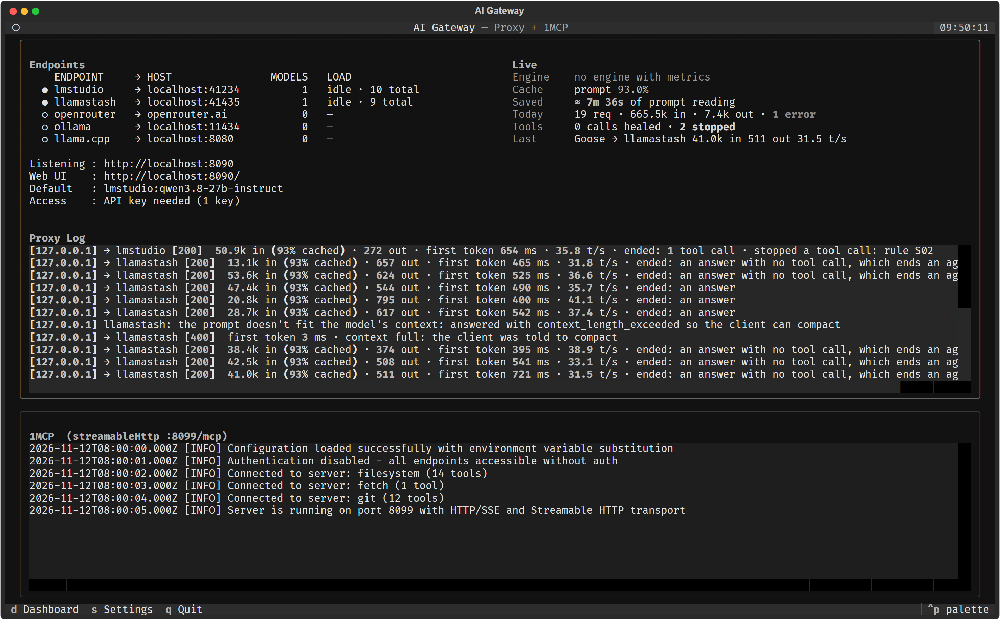
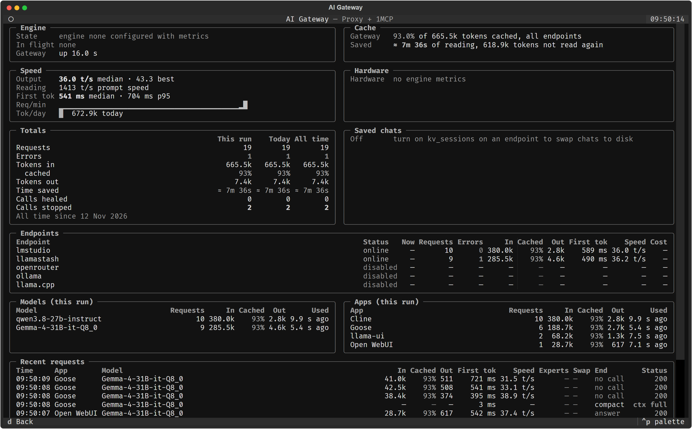
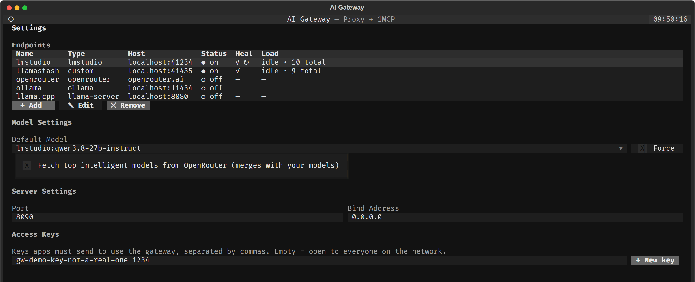
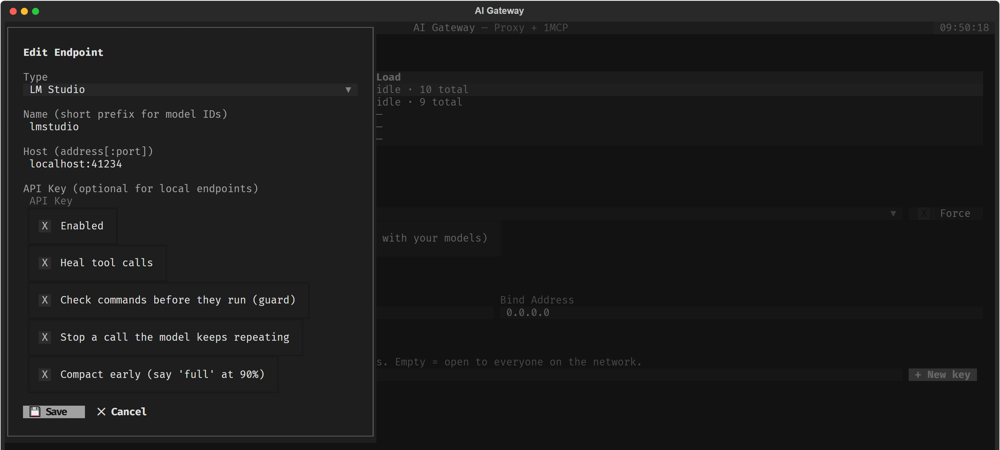
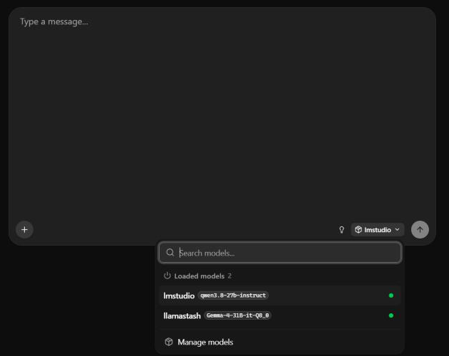

# AI Gateway

**One address for all your AI models, cloud and local, for every app and device on your network.**

AI Gateway is a small proxy you run on one PC. It connects to OpenRouter, OrcaRouter, LM Studio, llama.cpp, Ollama, Strata and any other OpenAI-compatible server at the same time, and gives every app on your network one address with all their models in one list. It comes with a terminal console to watch and manage it, and a web chat page anyone on the network can open.

It also fixes the things that usually end a long coding-agent run on a local model: tool calls written as text, a model stuck repeating one call, and a chat that outgrows its context window.



| Live dashboard (`d`) | Settings (`s`) |
|:---:|:---:|
|  |  |
| **An endpoint's options** | **The web chat page** |
|  |  |

<sub>Screenshots are from a demo setup with made-up traffic.</sub>

## What you get

- **Every model in one list.** Apps see `openrouter:openai/gpt-5.6-luna`, `lmstudio:qwen3-8b` and the rest side by side, and the gateway sends each request to the right place. API keys stay on the gateway, so apps and family devices need none.
- **A chat page for everyone.** Open `http://YOUR_PC:8090/` on any phone or laptop: streaming answers, file and image uploads, conversation history and MCP tools, no account needed.
- **A console that shows what's happening.** Which endpoints are up, what each request cost in tokens and time, how much came from the cache, and a full dashboard on `d`.
- **Long agent runs that keep going** on local models, with these per-endpoint options (all off until you turn them on):
  - [Tool call healing](#tool-call-healing): a call the model wrote as text becomes a real one, and risky commands are checked before they run.
  - [Repeat stop](#a-call-the-model-keeps-repeating): a model stuck on the same call is told so before the app gives up on the task.
  - [Compact early](#when-a-chat-reaches-the-context-limit): the app is told "context full" while the whole chat still fits, so nothing it cuts is lost.
  - [Saved chats](#long-chats-on-a-local-engine-kv-session-swap): several long chats share an engine that holds one at a time.
- **Open or locked, your choice.** By default anyone on your network can use it. Add [access keys](#access-keys) and every app must send one.
- **Private by design.** The gateway never keeps chat text. Stats, logs and saved files hold counts and names only.

```
                    ┌──────────────────────────────┐
  Phone / laptop ──►│                              ├──► OpenRouter, OrcaRouter (cloud)
  (web chat page)   │   AI Gateway  :8090          ├──► LM Studio, llama.cpp, Ollama (local)
  Cline, Goose, ───►│   console + web chat page    ├──► Strata
  any OpenAI app    │                              ├──► any OpenAI-compatible server
                    └──────────────────────────────┘
```

## Quick start

You need **Python 3.8+**. The `textual` library installs itself on first run.

1. Download or clone this project.
2. Copy `config.example.json` to `config.json` and put in your endpoints and API keys. (`config.json` is gitignored, so your keys never get committed.) You can also add endpoints later in the console's Settings.
3. Start it:
   ```bash
   python gateway_tui.py
   ```
   or double-click `run.cmd`. (`python proxy.py` runs the gateway alone, without the [MCP bridge](#mcp-servers-tools-for-the-chat-page).)

Then open `http://localhost:8090/` for the chat page, or `http://YOUR_PC_IP:8090/` from another device.

Local servers on their usual ports (llama.cpp on 8080, LM Studio on 1234, Ollama on 11434) are found on their own.

## Connect your apps

| App | Setting |
|---|---|
| **Cline** (recommended) | API Provider **LM Studio**, Base URL `http://YOUR_PC_IP:8090` (no `/v1`), API key empty. The model list fills itself. |
| **Cline**, other way | API Provider **OpenAI Compatible**, Base URL `http://YOUR_PC_IP:8090/v1`, any non-empty API key such as `sk-placeholder` |
| **Any OpenAI-compatible app** | Base URL `http://YOUR_PC_IP:8090/v1`, API key empty or anything |
| **Ollama-style apps** | `http://YOUR_PC_IP:8090` |
| **A browser** | `http://YOUR_PC_IP:8090/` |

If the gateway has [access keys](#access-keys), put one in the app's API key field. The chat page asks for it the first time it opens.

**For long agent runs on a local model**, open the console's Settings, choose the endpoint, press **Edit** and tick **Heal tool calls**, **Stop a call the model keeps repeating** and **Compact early**. A change applies to the next request, without a restart.

<details>
<summary>Why this matters for Cline</summary>

Cline 4.1.26 can show a 128k window in the chat header while its settings page shows the real one, and then compacts only after the engine refuses the prompt, by dropping messages. With [Compact early](#compacting-early-context_guard) the gateway summarizes what Cline drops, so the run continues from where it was instead of starting over. Cline also ends a task after 5 identical calls in a row; the [repeat stop](#a-call-the-model-keeps-repeating) steps in at the fourth.

</details>

## Access keys

Out of the box the gateway is open: anyone who can reach it on your network can use your models and your cloud credit. To lock it, give it one or more keys. Every app must then send one, the way it would send an OpenAI key.

1. Open **Settings** (`s`). Under **Access Keys**, press **+ New key** (or type your own, at least 16 characters).
2. Press `Ctrl+S`. The main screen now says `Access : API key needed`. No restart is needed.
3. Give the key to your apps: their **API key** field (Cline, Goose, Open WebUI and any OpenAI app). The web chat page asks for it the first time it opens and remembers it in that browser.

Give each person or device its own key, so you can take one away by deleting it.

<details>
<summary>Details: what is checked, config form, and limits</summary>

- **Sent as** `Authorization: Bearer <key>` (OpenAI apps), `x-api-key` (Anthropic apps) or `api-key`.
- **Checked on every API request**: models, chat, `/props`, `/health`, `/stats`, Ollama's paths and `/cors-proxy`. Only the web page's own files load without a key, so the page can open and ask for one.
- **A wrong or missing key** gets `401` with the OpenAI code `invalid_api_key`. The log notes it once a minute per address (`refused GET /v1/models: no access key`), never with the key.
- **Your key never goes upstream.** The gateway sends each endpoint its own `api_key` from the config. On `/cors-proxy` it keeps the key too, and passes on only the MCP server's own headers.
- **In `config.json`** keys are a list. A key can carry a name for your own notes:
  ```json
  "access_keys": ["gw-...", {"name": "laptop", "key": "gw-..."}]
  ```
  An empty list or no `access_keys` at all leaves the gateway open. A key shorter than 16 characters is ignored, so a typo can't leave the gateway guarded by a guessable key.
- **The connection isn't encrypted.** The gateway speaks plain HTTP, so keys and chats cross your network readable to anyone who can watch it. That's fine on a home network. To reach it from the internet, put it behind a VPN or an HTTPS reverse proxy instead of opening the port.
- **Images the chat page loads through `/cors-proxy`** (pictures from other sites in a reply) can't carry the key, so with keys on they don't show.

</details>

## Model names

A model's name is `endpoint:model`. The part before the first `:` is the endpoint's name in your config, and it decides where the request goes:

```
openrouter:openai/gpt-5.6-luna        → OpenRouter → openai/gpt-5.6-luna
orcarouter:anthropic/claude-sonnet-4.6 → OrcaRouter → anthropic/claude-sonnet-4.6
lmstudio:mistral-7b                    → LM Studio  → mistral-7b
ollama:llama3                          → Ollama     → llama3
strata:my-model                        → Strata     → my-model
```

The rest is the model's name as that server knows it, and may contain `/` or `:` itself.

<details>
<summary>How the model list is built</summary>

On startup, the gateway:

1. Finds local servers (llama-server on :8080, LM Studio on :1234, Ollama on :11434)
2. Checks every configured endpoint
3. For OpenRouter and OrcaRouter, lists only the models in your `models` list (not the full catalog of 340+)
4. For local servers, lists every model they have loaded
5. Builds one list with the endpoint name in front of each model
6. Repeats this every 30 seconds

Apps can ask about models in the OpenAI, LM Studio, llama.cpp and Ollama forms, for the whole list or for one model, and each answer carries the context window the model is loaded with. See **API endpoints** under [Reference](#reference).

</details>

## The console

The top of the main screen lists your endpoints, whether each is up, how many models it has and how many requests it is serving. Beside it, **Live** sums up today. Below is the request log: one line per request with tokens in and out, the cached share, time to the first token, speed and how the reply ended.

| Key | |
|---|---|
| `d` | Live dashboard (`d` or `Esc` to go back) |
| `s` | Settings: endpoints and their options, default model, port, bind address |
| `Ctrl+S` / `Ctrl+R` | Save settings / restart the server (in Settings) |
| `q` | Quit |

`gateway_tui.py` runs the same console with a second pane below it for [1MCP](https://github.com/1mcp-app/agent), which serves all your MCP servers on one port. `proxy.py` runs the console alone.

The console's log lines are also written to `gateway.log` beside `config.json`, counts and names only, cut back to its newer half at 5 MB. `"log_file": false` in `config.json` turns it off.

### Live stats

<details>
<summary>What the dashboard panels show, and where the numbers come from</summary>

| Panel | What it shows |
|-------|---------------|
| **Engine** | Model, state (reading with progress and time left, generating with speed, idle, not loaded), chat size against the context limit, requests in flight and queued |
| **Cache** | Prompt tokens reused, expert hit rate, drafts kept, chats parked in RAM, how each request found its chat (kept, restored, new), swap times, reading time saved |
| **Speed** | Output speed with a 60-second graph, reading speed, time to first token (median and p95), requests per minute, tokens per day |
| **Hardware** | GPU load, temperature, power, VRAM, PCIe traffic, CPU, RAM and disk |
| **Totals** | Requests, errors, tokens, cached share, time saved, calls healed and stopped, for this run, today and all time, plus cost when a cloud endpoint reports it |
| **Saved chats** | Each chat on disk: app, tokens, size, restores, last used. A dot marks the one in the engine |
| **Endpoints, Models, Apps** | Requests, tokens and cached share for each |
| **Recent requests** | Time, app, model, tokens, cached share, first token, speed, expert hits, what the swap did, how the reply ended (**End**) and the status |

Where the numbers come from:

- **Tokens and speed** are read from each response as it passes through, in the OpenAI, Anthropic, DeepSeek and Responses API formats, and from llama.cpp's `timings`. If an upstream reports no usage, streamed pieces are counted instead and shown with a `~`.
- **Engine, Hardware and the expert and draft figures** need an engine that publishes `/metrics`, which today means Strata. Other endpoints still get the gateway's own counts.
- **The app name** comes from the `X-Title` header. Without one, a browser on the gateway's own page shows as `Web UI`, then the referer's host is used, then the `User-Agent` product.
- **Time saved is an estimate:** cached tokens divided by the reading speed measured on that endpoint.
- **A client pressing stop** counts as stopped, not as an error.
- **How a reply ended** comes from the model's own stream, before any tool call healing. This helps when an agent stops on its own, because the model's last reply says why:

  | End | Meaning |
  |-----|---------|
  | `2 calls` | The reply made tool calls, so the app runs them and asks again |
  | `no call` | Tools were offered, but the reply was text only. An agent takes that as the end of its turn. If the text holds a tool call written out, `tool_heal` can turn it into a real one |
  | `cut off` | The reply hit the token limit (`max_tokens`, or the server's own response limit) |
  | `ctx full` | The context window filled up |
  | `no end` | The stream ended without saying why, which usually means it was cut off |
  | `empty` | No answer text, only reasoning, or nothing at all |
  | `answer` | A plain answer, with no tools offered |

  The log line spells it out, for example `ended: cut off at the token limit`.

No chat text is kept. The gateway reads token counts and timings from responses, and how each one ended: the finish reason, the number of tool calls and how many characters of text and reasoning it had. It passes the bytes on unchanged, and engine data is copied field by field from a fixed list. `gateway-stats.json`, beside `config.json` and gitignored, holds the all-time totals: counts plus endpoint, model and app names, with daily rows for 30 days. It's written every 30 seconds and on exit. Delete it to start the totals over.

`GET /stats` returns the same numbers as JSON. Like `/health` it needs no key, and it includes client addresses and app names, so anyone who can reach the gateway can read them.

</details>

## Tool call healing

Local models sometimes write a tool call out as plain text instead of making a real one. The app shows the text, nothing runs, and the agent stops. With **Heal tool calls** on, the gateway turns such a call into a real one, and its **guard** checks every command before the app runs it, so a damaged `rm -rf` never gets there.

Turn it on in Settings → endpoint → **Edit** → **Heal tool calls**. The **Heal** column in the endpoint table shows `✓` where it's on, and `↻` where the repeat stop is on too. Or in `config.json`:

```json
{ "name": "lmstudio", "type": "lmstudio", "host": "localhost:1234", "tool_heal": { "enabled": true } }
```

<details>
<summary>What it changes, and what it leaves alone</summary>

It's off by default, and then every reply passes byte for byte. When it's on, it only touches `/chat/completions` requests that offer tools. A reply with nothing to repair keeps every character, though text that could have started a call may arrive split differently.

| The model replies with | What the app receives |
|---|---|
| A complete call written as text, with a real tool name | A proper tool call, which runs |
| A complete call written as text, with a name the app doesn't have | A proper tool call under that same name. Nothing runs, and the app tells the model which tools exist, so it can correct itself |
| No answer and no call, but the reasoning ends with `</think>` followed by complete calls in Gemma 4's format (`<\|tool_call>call:name{…}<tool_call\|>`) | Proper tool calls. This happens with Gemma 4 finetunes on LM Studio: the model closes its thinking with the wrong tag, so the server leaves the call inside the reasoning and the agent stops |
| A call in a code fence, or a tag mentioned in a sentence | The text, unchanged: that's a quotation |
| A written call that is incomplete or was cut off | The text, unchanged. It never runs |
| A proper tool call that is safe | The same bytes, held until the whole call has arrived |
| A command the guard stops | A question to you, or a message to the model (below) |

Tool names are never guessed, and parameter values are never edited.

</details>

<details>
<summary>The command guard: rules and what happens when one fires</summary>

Every call that would run is checked, healed or not, for accidents that come from errors. It splits commands the way bash, PowerShell or cmd would, using the shell the app's tool says it runs, so `grep -rn "rm -rf" src/` passes and `rm -rf ./dist` passes.

| Rule | What it stops | Example |
|---|---|---|
| A1 | Broken arguments on a command or file tool, because an app's repair can change what they mean (Cline's repair turns `rm -rf C:\Users\me` into `rm -rf C:Usersme`) | `{"commands":["rm -rf ./x", ]}` |
| T1 | A command or file call in a reply that was cut off | `finish_reason: length` |
| S01 | Deleting a path that is only a variable | `rm -rf "$DIR/"` |
| S02, S05 | Deleting a root, home, drive, system or top-level folder | `rm -rf ~`, `Remove-Item C:\ -Recurse` |
| S03 | A path that lost its backslashes | `rm -rf c:demo` |
| S04 | A PowerShell variable that was never set, so the path starts at the drive root | `Remove-Item "$dir\build" -Recurse` |
| S06, S13 | Deleting an unfiltered list | `Get-ChildItem -Recurse \| Remove-Item`, `find . -delete` |
| S09 | A redirect that empties a file | `sort data.txt > data.txt` |
| S10 | A control character in a path, usually a damaged `\n` or `\t` | `C:\temp` decoded with a tab |
| S11, S12 | Losing uncommitted work or history | `git reset --hard`, `git push --force origin main` |
| S14, S15, S16 | Disks, root permissions, shutting down, registry deletes | `mkfs`, `chmod -R 777 /`, `reg delete` |
| S17 | Commands that can't be read | `curl … \| sh`, `iex`, `powershell -enc` |
| S18, S19, S20 | Paths that climb out, unquoted spaces, empty paths | `rm -rf ../..`, `rm -rf ""` |

When a command is stopped, nothing of it reaches the app:

- **If the app offers `ask_question`,** you're shown the command and the reason, and your answer goes back to the model. The guard has no override, so a command you really want is yours to run yourself.
- **Otherwise, and for A1 and T1,** the model receives a call to a tool named like `gateway_stopped_S02_destructive_command_was_not_run`. The app answers that the tool doesn't exist, and the turn carries on with the rule in view.

Options, inside `tool_heal`:

| Option | Default | Effect |
|---|---|---|
| `guard` | `true` | `false` keeps the healing and turns off every check |
| `allow_rules` | `[]` | Rule ids to let through, such as `["S11"]` |
| `stop_repeats` | `false` | Stop a call the model keeps repeating (below) |
| `repeat_limit` | `3` | How many identical calls in a row may run (2 to 20) |

What it can't do:

- **It catches accidents, not intent.** A command can always hide what it does, for example inside a script or `npm run clean`. Keep your app's approval settings on.
- **It doesn't know the working folder,** so `rm -rf build` in the wrong folder passes.
- **In bash, a line break can't be told from a damaged `\n`,** because multi-line scripts are normal there. PowerShell and cmd ask you when a delete's path runs straight into a line break, so a script with a delete like that gets a question. Put `-Recurse` last or use `;` to avoid it.
- **A made-up tool name costs one retry,** and the model has to write the call again.
- **Calls are held until they're complete,** so a long file edit appears all at once rather than streaming. Keep-alive chunks are sent while it waits.
- **It only reads `/chat/completions` replies.** `/v1/messages` and `/v1/responses` pass untouched, and so does anything the engine serves directly.

Nothing about a reply is kept. The log and stats get counts and rule ids only.

</details>

### A call the model keeps repeating

A stuck model makes the same call again and again, and some apps then end the whole task (Cline 4.1.26: "Detected 5 consecutive identical calls"). With **Stop a call the model keeps repeating** on, the gateway lets the same call run three times in a row and replaces the fourth with a note to the model, so it changes course and the task carries on. You are never asked, so an unattended run keeps going.

```json
"tool_heal": { "enabled": true, "stop_repeats": true }
```

<details>
<summary>How it decides, exactly</summary>

- **After the same call three times in a row, the fourth isn't sent.** The model gets a call to a tool named `gateway_stopped_R1_same_call_repeated_in_a_row_use_its_result_or_change_the_call` instead. The app answers that the tool doesn't exist, the model reads the name, and the task carries on. Because that call is a different one, the app's own count starts again.
- **The same call means the same tool and the same arguments.** JSON spacing and key order don't matter. One changed character in an argument is a different call.
- **The count is read from the request itself,** which carries the chat's earlier calls, so the gateway keeps nothing between turns. Tool results are stepped over. A message from you, an answer in words, or any other call between two turns starts the count again.
- **The model is told once.** If it makes the call again after that, it runs, and the count starts from one. A call that really must repeat, such as checking on a build, costs one extra turn in four.
- **One reply that makes the same call more than three times** is stopped as a whole (rule R2). Up to three passes, since pressing a key three times is a real thing to ask for.
- **You are never asked.** Unlike the command guard, this never uses `ask_question`.
- `repeat_limit` (2 to 20, default 3) sets how many identical calls in a row may run. Keep it below your app's own limit.

The console shows `guard R1` for that request and the log says `stopped a tool call: rule R1`.

</details>

## When a chat reaches the context limit

The gateway doesn't shorten chats itself. It makes sure your app can, at the right time: apps are told the context window the model is **really loaded with**, and when a chat no longer fits, they get the standard `context_length_exceeded` error that makes them compact and retry instead of stopping. From 90% full, the console shows how full each chat is.

<details>
<summary>Details: what apps are told, and when</summary>

- **Apps are told the context window that is loaded.** `/v1/models` (`context_length`, `context_window`, `max_model_len`) and `/props` (`n_ctx`) report what the model is loaded with, such as 32,000, and `max_context_length` holds the model's maximum. Agent apps use this number to decide when to compact, so a wrong one means they compact too late.
- **A lookup of one model is answered too:** `/v1/models/<id>`, `/api/v0/models/<id>` and Ollama's `/api/show`, `/api/tags` and `/api/ps`, by the gateway's id (`strata:model`) or the engine's own. An app that asks about its model this way and gets no answer falls back to a default of its own, often 128,000. The log shows which lookups each app makes (`model lookup: GET /v1/models/<model>`), so you can tell where an app gets its number from.
- **The window doesn't change while an engine is busy.** When an endpoint can't be asked for a moment (Strata while it generates, for example), each model keeps the window it last reported. Only a model whose window was never reported gets a default of 128,000, and the gateway never acts on that guess: no "full" from the context guard and no share in the stats.
- **A full context reaches the app as the standard error.** When an engine answers that the prompt doesn't fit, each says it its own way (llama.cpp: "exceeds the available context size"). The gateway answers `400` with the OpenAI code `context_length_exceeded`, a message with the token counts where the engine gave them, and the engine's own words. Apps with overflow recovery, such as Cline, then compact and retry instead of stopping. `/v1/messages` gets Anthropic's form of the same error. Any other error passes byte for byte.
- **The console shows it coming.** From 90% of the window, the **In** column of Recent requests shows the share used, for example `241k 92%`, and the log line says `context 92% full`. A request that hit the limit shows `ctx full`.

</details>

### Compacting early (`context_guard`)

Some apps only compact after the engine refuses the prompt. By then the chat no longer fits, so nothing can read all of it, and what the app cuts is lost. With **Compact early** on, the gateway says "full" at 90%, while the whole chat still fits, and then makes sure the app's compaction gets everything it cut, as the full messages or as a summary written by the model.

```json
"context_guard": { "enabled": true }
```

<details>
<summary>How it works, settings and log lines</summary>

1. **At 90% of the window**, the gateway answers `context_length_exceeded` without asking the engine, and keeps that request's messages in memory.
2. **The app's next request** is then one of two things:
   - **A compact request:** a cut-down chat followed by a new instruction. The gateway puts the cut messages back, so the app's compaction reads the whole chat.
   - **The same turn again, with messages cut out.** The gateway asks the engine to summarize the chat up to the last cut message. That prompt is the start of the chat the engine just held, so it comes mostly from its cache. The summary is added to that turn, and to the front of the reply, where the app keeps it in its own history.
3. **Anything unclear goes through as the app sent it:** a different chat, a failed summary, or nothing really cut.

| Setting | Default | Meaning |
|---------|---------|---------|
| `enabled` | `false` | Turn the guard on for this endpoint |
| `at` | `0.9` | The share of the context window where "full" is said (0.5 to 0.99) |
| `summary_tokens` | `2000` | The most the summary may be |

What to know:

- **The token count is an estimate** until the engine has read the prompt: the request's size divided by bytes per token, learned from finished requests. Nothing is said before one request has finished.
- **The request right after a "full" is never refused**, so an app can't be locked out.
- **The chat is held in memory only**, for that one follow-up request or 15 minutes, and never written or logged. The log shows counts, such as `6 cut, 0 new at the end`.
- **A summary costs one extra generation**, and the shortened chat is read again afterwards. The summary request is the app's own request again, with the same tools and settings, so the engine can read the chat from its cache instead of from the start.
- **The summary keeps decisions, file names and what is left to do**, not the contents of files the model had read. Expect some re-reading after a compaction.

The log shows each step, with counts only:

```
context guard: about 236,410 of 262,144 tokens (90%), answered context_length_exceeded so the client compacts while the chat still fits
context guard: the request after 'full' has 103 messages, 69 from the full chat of 149, 80 cut, 0 new at the end
context guard: summarised 80 cut messages into 3,961 characters and added them to this turn
```

</details>

## Thinking on or off

Your app decides whether the model thinks, and the gateway makes sure the server hears it. LM Studio only understands one way of saying it, so on LM Studio endpoints the gateway translates your app's choice. Nothing is set in the gateway's own config.

<details>
<summary>The translation table</summary>

| Your app sends | LM Studio gets |
|----------------|----------------|
| `reasoning_effort` | It, unchanged |
| `chat_template_kwargs: {"enable_thinking": false}` (llama.cpp, vLLM) | `reasoning_effort: "none"` |
| `reasoning: {"enabled": false}` or `reasoning: {"effort": "low"}` (OpenRouter) | `"none"`, or that level |
| `thinking: {"type": "disabled"}` (Anthropic) | `"none"` |
| `think: false` (Ollama) | `"none"` |
| Thinking on with no level, or nothing at all | Nothing added: the model's **Enable Thinking** setting in LM Studio decides |

Your app's own `reasoning_effort` is never changed, and its other fields are passed on too. Other endpoint types, and LM Studio's `/v1/responses`, get the request exactly as sent.

This was tested with a Gemma 4 model. With `reasoning_effort: "none"`, LM Studio skipped thinking and still made the right tool call. It ignored `chat_template_kwargs` and `reasoning: {"effort"}`.

Each log line shows what your app asked for, such as `thinking off (asked)`, and `GET /stats` has it as `think`. That shows whether your app sends a choice at all.

</details>

## Long chats on a local engine (KV session swap)

A local engine like Strata holds one conversation at a time. When several apps each keep a long chat there, every switch makes the engine read the other chat again from scratch: 15 minutes or more at 500k tokens. With `kv_sessions` on, the gateway saves the held chat to disk and restores the right one before each request, so a switch takes seconds. Apps need no changes.

<details>
<summary>Setup, settings and costs</summary>

**Turn it on (Strata):**

1. Create a folder for the session files, then add it to the model's run config (`strata-<model>.json`) and load the model again:
   ```json
   "slot_save_path": "D:\\Strata\\sessions"
   ```
2. Add this to the Strata endpoint in `config.json` and restart the gateway:
   ```json
   "kv_sessions": {"enabled": true}
   ```

The gateway finds the engine's port and key in Strata's own run files on each request. For another engine with the same slot API (`POST /slots/0?action=save|restore`), set `engine` and, if it has one, `engine_api_key`. Chats are recognised by hashes of their messages.

| Setting | Default | Meaning |
|---------|---------|---------|
| `enabled` | `false` | Turn the swap on for this endpoint |
| `engine` | found for Strata | `host:port` of the engine's own server |
| `engine_api_key` | found for Strata | That server's API key |
| `slot_dir` | found for Strata | The engine's session folder (only needed for `max_gb`) |
| `min_tokens` | `30000` | A shorter chat is cheap to read again, so it isn't saved |
| `min_gain_chars` | `4000` | Restore a saved chat only if it matches this many more characters than the held one |
| `idle_save_s` | `600` | Save the held chat after this many seconds without requests (`0` = off) |
| `max_gb` | `0` | Keep at most this much on disk, deleting the oldest of its own files first (`0` = never delete) |

**What it costs:**

| | Measured with Strata on an NVMe drive |
|---|---|
| Disk | About 16.7 KB per token: 1.7 GB at 104k tokens, about 8.5 GB at 512k (estimated) |
| Save / restore | 2.2 s / 3.0 s at 104k tokens, about 11 s / 15 s at 512k (estimated) |
| Reading the same chat from scratch | 274 s at 104k tokens, over 20 minutes at 370k |

- There is no limit on the number of swaps or saved chats except disk space. Set `max_gb` to cap it.
- A save rewrites the whole chat, and only happens if the chat changed since its last save. Switching back and forth often writes a lot to the SSD.
- The engine still runs one request at a time, so apps take turns.
- A chat comes back in full only if the app resends the same history. If it trims or rewrites older messages, the part after the first change is read again.

The gateway never opens session files, and its index (`kv-sessions-<endpoint>.json`) holds message hashes and counts only, never chat text. The index also records which chat the engine holds, so restarting the gateway doesn't make it forget. The first request after a restart checks that record against the engine's own token count. If the engine holds a long chat (`min_tokens` or more) that the gateway can't identify, no saved chat is restored over it, because it may be the same chat, newer than its saved copy. If another app uses the engine directly, the next switch back to a saved chat therefore reads it again once. `GET /health` shows the sessions, the held chat and the save and restore counts, and the log shows each swap. If the engine has slot saving off, requests are forwarded as usual and the log says what to change.

If the engine answers a save or restore with an error 500, swapping turns off until the model is reloaded, or for 30 minutes. Strata 0.1.57 can get into a state where every snapshot fails with `conversation snapshot: invalid K/V extent`. The console then shows **Swap: off until the model is reloaded** with the engine's reason, and `GET /stats` has it under `kv_sessions` as `suspended` and `last_error`. Reloading the model in Strata brings saving back.

</details>

## The web chat page

The chat page is [llama.cpp's llama-ui](https://github.com/ggml-org/llama.cpp/tree/master/tools/ui), served by the gateway: streaming answers, every model from every endpoint in one picker, conversations you can branch, edit and search, image, PDF, audio and text attachments, markdown with code highlighting and math, and a dark or light theme. Uploads of images, audio and video turn on for models that accept them.

<details>
<summary>Showing full model names in the picker</summary>

By default the model picker shows short names with badges. To see the full name with its endpoint (`openrouter:z-ai/glm-5.3-flash`), open **Settings** (gear icon) → **Display** → **Show raw model names**. The setting is kept in the browser.

</details>

### MCP servers (tools for the chat page)

The chat page can give the model tools from MCP servers. Add an HTTP MCP server by URL in its MCP Servers screen, with **Use llama-server proxy** on so the gateway passes the traffic through.

For servers that run as a command (stdio), list them in `mcp.json` (gitignored). `gateway_tui.py` starts [1MCP](https://github.com/1mcp-app/agent), which serves **all** of them behind one address, `http://localhost:8099/mcp`. Add that one URL with the proxy toggle on, and every server's tools appear (named `server___tool`). It needs Node.js and `npx` on the PATH.

```json
{
  "mcpServers": {
    "filesystem": { "type": "stdio", "command": "npx", "args": ["-y", "@modelcontextprotocol/server-filesystem", "C:/path/to/folder"] }
  }
}
```

<details>
<summary>How the proxy toggle is kept safe</summary>

The toggle routes the MCP server's traffic through the gateway's `/cors-proxy`, which gets around the browser's CORS and mixed-content rules. The gateway forwards the MCP session handshake (`Mcp-Session-Id`) so stateful servers work.

`/cors-proxy` only answers the gateway's own page (and non-browser clients): a page from another site gets `403`, so it can't use the gateway to reach services that only listen on this PC. Open the chat page by IP, `localhost`, the PC's name (`my-pc`) or a `.local`/`.lan`/`.home` name; a name with a public domain is refused, which blocks DNS rebinding.

</details>

## Configuration

Most of it can be done in the console's Settings (`s`). It's all kept in `config.json`:

```json
{
  "endpoints": [
    { "name": "openrouter", "type": "openrouter", "host": "openrouter.ai", "enabled": true, "api_key": "sk-or-v1-YOUR_KEY_HERE" },
    { "name": "lmstudio", "type": "lmstudio", "host": "localhost:1234", "enabled": true, "api_key": "",
      "tool_heal": { "enabled": true, "stop_repeats": true },
      "context_guard": { "enabled": true } },
    { "name": "ollama", "type": "ollama", "host": "localhost:11434", "enabled": true, "api_key": "" }
  ],
  "models": ["openrouter:openai/gpt-5.6-luna", "openrouter:z-ai/glm-5.3-flash"],
  "default_model": "",
  "port": 8090,
  "addr": "0.0.0.0"
}
```

<details>
<summary>Every setting</summary>

| Field | Description |
|-------|-------------|
| `endpoints` | Your AI servers (name, type, host, api_key, enabled; optional `timeout` in seconds per upstream read — default 180 for cloud, 600 for local) |
| `models` | The cloud models to list, each as `endpoint:model` |
| `default_model` | Model used when a request names none (empty, or not available → the first available model) |
| `force_default_model` | When `true` (the **Force** checkbox next to Default Model in Settings), every chat request (`…/completions`, `/responses`, `/messages`) uses the default model, whatever model the app asks for; other requests such as embeddings are left alone |
| `port` | HTTP port (default 8090) |
| `addr` | Bind address (`0.0.0.0` = all interfaces) |
| `fetch_top_models` | When `true`, adds the top 20 intelligent models from OpenRouter to your list |
| `access_keys` | Keys apps must send to use the gateway; empty or missing = open. See [Access keys](#access-keys) |
| `log_file` | `false` turns off `gateway.log`. On by default |

Options per endpoint, all off unless you turn them on:

| Endpoint option | What it does | Checkbox in Settings |
|-----------------|--------------|----------------------|
| `"tool_heal": {"enabled": true}` | [Turns tool calls written as text into real ones](#tool-call-healing) and checks commands before they run | **Heal tool calls**, **Check commands before they run (guard)** |
| `"tool_heal": {…, "stop_repeats": true}` | [Stops a call the model keeps repeating](#a-call-the-model-keeps-repeating) | **Stop a call the model keeps repeating** |
| `"context_guard": {"enabled": true}` | [Says "context full" early](#compacting-early-context_guard) and keeps what the app cuts | **Compact early** |
| `"kv_sessions": {"enabled": true}` | [Saves and restores chats](#long-chats-on-a-local-engine-kv-session-swap) on an engine that holds one at a time | — |

A change made in Settings applies to the next request. No restart is needed.

**Endpoint types:**

| Type | Description | Health check |
|------|-------------|-------------|
| `openrouter` | OpenRouter cloud API | `GET /api/v1/models` |
| `orcarouter` | OrcaRouter cloud API | `GET /api/v1/models` |
| `lmstudio` | LM Studio local server | `GET /v1/models` |
| `llama-server` | llama.cpp server | `GET /health` |
| `ollama` | Ollama local server | `GET /api/tags` |
| `strata` | Strata gateway (default `127.0.0.1:47831`) — vision and context follow the model loaded in Strata | `GET /v1/models` |
| `custom` | Any OpenAI-compatible server (e.g. llamastash) | `GET /v1/models` |

</details>

## Reference

<details>
<summary>API endpoints</summary>

With [access keys](#access-keys) on, every one of these needs a key.

| Endpoint | Format | Purpose |
|----------|--------|---------|
| `GET /v1/models` | OpenAI standard | Standard clients, OpenAI Compatible provider |
| `GET /api/v0/models` | LM Studio | Cline LM Studio provider, LM Studio clients |
| `GET /api/v1/models` | LM Studio | Alias for `/api/v0/models` |
| `GET /v1/models/<id>`, `GET /api/v0/models/<id>` | OpenAI / LM Studio | One model's entry, by the gateway's id or the engine's own. Apps ask this to learn a model's context window |
| `GET /api/tags`, `GET /api/ps`, `POST /api/show` | Ollama | Model list and one model's info (`num_ctx`, `<arch>.context_length`), for apps that ask an Ollama-style server |
| `GET /props` | llama.cpp | Server properties: modalities, loaded context (`n_ctx`), parameters |
| `POST /v1/chat/completions` | OpenAI standard | Chat completions (sent to the right endpoint) |
| `GET /health` | JSON | Endpoint statuses |
| `GET /stats` | JSON | [Live stats](#live-stats): the gateway's counts, engine numbers and saved chats |
| `GET/POST /cors-proxy` | llama.cpp | CORS proxy for the chat page's MCP servers, served to the gateway's own page only |

</details>

<details>
<summary>Tested backends</summary>

| Backend | Status | Notes |
|---------|--------|-------|
| OpenRouter | ✅ Tested | Streaming, model switching, metadata |
| OrcaRouter | ✅ Tested | Streaming, tools, vision, multi-provider routing |
| LM Studio | ✅ Tested | Loaded context window reported, thinking switch, tool call healing (Gemma 4 calls after `</think>`), context guard |
| Strata | ✅ Tested | Vision and context follow the loaded model. KV session swap, engine stats, tool call healing, context guard |
| llama.cpp server | ✅ Tested | Health check via `/health`, model info via `/props` |
| Ollama | ✅ Tested | Health check via `/api/tags`, model discovery, OpenAI-compatible chat API |
| vLLM | ⏳ Pending | Expected to work (OpenAI-compatible API) |

</details>

<details>
<summary>Project structure</summary>

```
.
├── proxy.py              # Main application (proxy + console + static server)
├── gateway_tui.py        # Split-view console (proxy + 1MCP bridge)
├── config.example.json   # Committed template — copy to config.json
├── config.json           # Your settings (endpoints, models, port) — gitignored
├── mcp.json              # MCP servers aggregated by 1MCP — gitignored
├── gateway-stats.json    # All-time stats, counts only — written at run time, gitignored
├── gateway.log           # The console's log lines, counts only — written at run time, gitignored
├── kv-sessions-*.json    # KV session swap index, hashes and counts only — gitignored
├── build-webui.cmd       # One-click web UI build script
├── run.cmd               # Quick-start batch file
├── webui/                # Built web UI static files
├── webui-src/            # llama.cpp source (gitignored, see "Building the web UI")
├── changelogs/           # Release notes, one file per version (vX.Y.Z.md)
├── screenshots/          # The pictures in this README
├── testing/              # Automated test suite (python testing/test_proxy.py)
├── .gitignore
└── README.md
```

</details>

<details>
<summary>Building the web UI</summary>

The bundled `webui/` is already built, so this is only needed to update it. After building, Python serves the static files directly, with no Node.js at run time. Building needs **Node.js 20+**.

```bash
# First time: clone the llama.cpp source (the build script expects it here)
git clone https://github.com/ggml-org/llama.cpp.git webui-src

# Option A: build from the cloned source
build-webui.cmd

# Option B: copy <llama.cpp>/build/tools/ui/dist/ from a local llama.cpp build into webui/
```

</details>

<details>
<summary>Tests</summary>

Over 300 tests, using Python's built-in `unittest`:

```bash
python testing/test_proxy.py
```

They start mock upstreams and a gateway in the same process and make real HTTP requests. They cover model lists and lookups, routing, `/cors-proxy` and the MCP session handshake, KV session swap, live stats, tool call healing, the command guard and the repeat stop, the context limit and context guard, the thinking switch and the log file. No running gateway, online model or API key is needed, and all chat text in them is made up.

`testing/live_kv_check.py` checks the KV session swap against a real engine. It needs a loaded model, takes a few minutes, and uses only made-up text.

</details>

## License

The gateway works with OpenRouter's and other servers' APIs. The web chat page is from the [llama.cpp](https://github.com/ggml-org/llama.cpp) project (MIT License).
